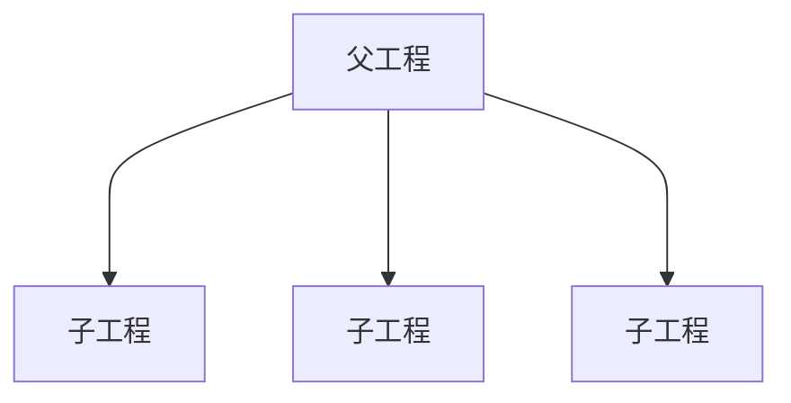

# 一、安装配置


## `1.1` `Maven` 官网

| `Maven` 官网                                                 | `Maven` 历史版本下载                                         | `Maven` 仓库                                                 |
| ------------------------------------------------------------ | ------------------------------------------------------------ | ------------------------------------------------------------ |
| [https://maven.apache.org](https://maven.apache.org "Maven") | [https://archive.apache.org/dist/maven/maven-3](https://archive.apache.org/dist/maven/maven-3/ "历史版本Maven")<br />下载 `apache-maven-3.8.6-bin.zip`，发布于 `2022-06-06`，`SpringBoot 2.7.18` 推荐使用该版本 | [https://mvnrepository.com](https://mvnrepository.com "mvnrepository") |


## `1.2` 下载安装

1. 下载 `Maven` 解压

2. 在`/conf/settings.xml`下修改，仓库存储地址，阿里云镜像等3处

   55 行左右，添加以下内容

   ```xml
   <localRepository>D:\Software\Maven\apache-maven-3.8.6\repository</localRepository>
   ```

   `<mirrors></mirrors>` 标签下，注释原来的 `mirror`，添加下面部分

   ```xml
   <mirror>
     <id>nexus-aliyun</id>
     <mirrorOf>central</mirrorOf>
     <name>Nexus aliyun</name>
     <url>http://maven.aliyun.com/nexus/content/groups/public</url>
   </mirror>
   ```

   `<profiles></profiles>` 下

   ```xml
   <!-- jdk 8 -->
   <profile>
     <id>jdk-1.8</id>
     <activation>
       <activeByDefault>true</activeByDefault>
       <jdk>1.8</jdk>
     </activation>
     <properties>
       <maven.compiler.source>1.8</maven.compiler.source>
       <maven.compiler.target>1.8</maven.compiler.target>
       <maven.compiler.compilerVersion>1.8</maven.compiler.compilerVersion>
     </properties>
   </profile>
   ```

   ```xml
   <!-- jdk 17 -->
   <profile>
     <id>jdk-17</id>
     <activation>
       <activeByDefault>true</activeByDefault>
       <jdk>17</jdk>
     </activation>
     <properties>
       <java.version>17</java.version>
       <maven.compiler.release>17</maven.compiler.release>
     </properties>
   </profile>
   ```

3. 改变 `idea` 的 `Maven` 配置，配置方式与步骤2一样

   `D:\Software\JetBrains\IntelliJ IDEA 2021.1.3\plugins\maven\lib\maven3\conf\settings.xml`

4. 改动一下 `idea` 的默认 `maven` 设置

   `File` -> `New Projects Setup` -> `Settings for New Projects...`

   `Settings` 也顺带改一下：`Settings` -> `Build, Execution, Deployment` -> `Build Tools` -> `Maven`


# 二、`Maven` 基础概念

**`Maven` 是 `Java` 生态的项目管理与构建工具**，由 Apache 推出，核心解决两件大事：**依赖管理** + **项目构建**。

>   类比理解： 相当于前端的 `npm` / `yarn`，同时自带打包、编译、测试的构建能力


## `2.1` 构建 `Maven JavaSE` 工程

默认构建的就是 `Maven JavaSE` 工程，打包成 `jar`


## `2.2` 构建 `Maven JavaEE` 工程

1.   创建一个 `javasemaven` 工程

2.   手动添加 `web` 项目结构文件

     再 `main` 目录下（与 `resources` 同级）建立 `webapp/WEB-INF/web.xml`

3.   修改 `pom.xml` 文件打包方式为 `war`

     ```xml
     <groupId>com.maven</groupId>
     <artifactId>maven_parent</artifactId>
     <version>1.0-SNAPSHOT</version>
     <!-- 新增一列打包方式 packaging -->
     <packaging>war</packaging>
     ```

4.   刷新和校验 `Maven`

>   可以按需下个 `JBLJavaToWeb` 插件，简化转化过程


# 三、`Maven` 依赖管理

## `3.1` 第三方依赖声明 `dependency`

`Maven` 使用 `dependency` 声明项目所需的第三方依赖

```xml
<dependencies>
    <dependency>
        <groupId></groupId>
        <artifactId></artifactId>
        <version></version>
        <type></type>
        <classifier></classifier>
        <scope></scope>
        <optional></optional>
        <exclusions>
            <exclusion>
                <groupId></groupId>
                <artifactId></artifactId>
            </exclusion>
        </exclusions>
    </dependency>
</dependencies>
```

| 标签         | 作用                                                     | 是否常用                                                     |
| ------------ | -------------------------------------------------------- | ------------------------------------------------------------ |
| `groupId`    | 依赖所属组织或项目的标识                                 | 必需                                                         |
| `artifactId` | 依赖构件名称                                             | 必需                                                         |
| `version`    | 依赖版本                                                 | 通常需要，版本也可以由父 `POM` 或 `dependencyManagement` 管理 |
| `scope`      | 指定依赖作用域                                           | 常用                                                         |
| `optional`   | 控制依赖是否向下游传递                                   | 偶尔                                                         |
| `exclusions` | 排除某个依赖传递引入的其他依赖                           | 常用                                                         |
| `type`       | 指定依赖构件类型，默认是 `jar`                           | 偶尔                                                         |
| `classifier` | 区分同一构件的不同变体，例如带有特定平台或附加内容的构件 | 偶尔                                                         |


### `3.1.1` `Maven` 的 `GAVP`

```xml
<dependency>
    <groupId>com.example</groupId>
    <artifactId>user-service</artifactId>
    <version>1.0.0</version>
    <packaging>jar</packaging>
</dependency>
```

`Maven` 中的 `GAVP` 是指 `Groupld`、`Artifactld`、 `Version`、`Packaging` 等四个性的缩写，其中前三个是必要的，而 `Packaging` 属性为可选项

| 简称 | Maven 属性   | 含义                                   | 示例                                          |
| ---- | ------------ | -------------------------------------- | --------------------------------------------- |
| `G`  | `groupId`    | 组织或项目的标识，通常采用反向域名格式 | `com.{公司/BU }.业务线.[子业务线]`，最多 4 级 |
| `A`  | `artifactId` | 构件名称，通常是模块或项目名称         | `产品线名-模块名`；如 `user-service`          |
| `V`  | `version`    | 构件版本号                             | `主版本号.次版本号.修订号`；如 `1.0.0`        |
| `P`  | `packaging`  | 构件的打包类型                         | `jar`、`war`、`pom`、`ear`                    |

-   **`jar`**：默认值，`Java` 项目的标准打包方式，包含 `Java` 类和资源文件。
-   `war`：用于 `Web` 应用程序的打包方式，包含了 `Web` 应用所需的所有文件。
-   `pom`：用于打包 `Maven` 项目本身的信息，包含了项目的依赖、插件等信息。
-   `ear`：用于企业级 `Java` 应用程序的打包方式，包含了多个模块的 `JAR`、`WAR` 等文件。


### `3.1.2 ` `scope` 作用域

`scope` 用于指定依赖的作用范围，影响依赖在编译、测试、运行等阶段的可用性，以及依赖传递行为

```xml
<dependency>
    <groupId></groupId>
    <artifactId></artifactId>
    <version></version>
    <scope>runtime</scope>
</dependency>
```

| 作用域     | 编译主代码 | 编译测试代码 | 运行 | 依赖传递 | 典型用途                                   |
| ---------- | ---------- | ------------ | ---- | -------- | ------------------------------------------ |
| `compile`  | 是         | 是           | 是   | 是       | 普通业务依赖，默认值                       |
| `provided` | 是         | 是           | 是*  | 否       | `Servlet API` 等由运行环境提供的依赖       |
| `runtime`  | 否         | 是           | 是   | 是       | `JDBC` 驱动等运行时依赖                    |
| `test`     | 否         | 是           | 否*  | 否       | `JUnit` 等测试专用依赖                     |
| `system`   | 是         | 是           | 是*  | 否       | 本地指定的 `JAR`，不推荐使用               |
| `import`   | —          | —            | —    | —        | 仅用于 `dependencyManagement` 中导入 `BOM` |

可选属性 `scope`：引入依赖的作用域

- `compile`（默认值）：依赖在编译、测试、运行阶段都有效
- `provided`：依赖在编译阶段有效，但在打包阶段（例如 `WAR` 包构建）不会被包含
- `runtime`：依赖在运行和测试阶段有效，但不会被编译
- `test`：依赖仅在测试编译和运行测试时有效，不会被打包


### `3.1.3` `optional` 可选依赖

`optional` 用于控制依赖是否向下游项目传递

```xml
<dependency>
    <groupId></groupId>
    <artifactId></artifactId>
    <version></version>
    <optional>true</optional>
</dependency>
```

-   `false`（默认值）：允许该依赖正常传递给依赖当前项目的其他项目
-   `true`：该依赖不会自动传递给依赖当前项目的其他项目，需要下游项目自行声明

>   1.   假设项目 `A` 的 `pom.xml` 声明了 `Jackson`
>
>        ```xml
>        <dependency>
>            <groupId>com.fasterxml.jackson.core</groupId>
>            <artifactId>jackson-databind</artifactId>
>            <version>2.18.3</version>
>            <optional>false</optional>
>        </dependency>
>        ```
>
>   2.   项目 `B` 依赖项目 `A`，项目 `C` 又依赖项目 `B`
>
>   3.   只要中间没有其他依赖规则排除它，`Jackson` 就可以通过依赖传递进入 项目 `B` 和项目 `C` 的依赖树中
>
>   4.   如果 `<optional>true</optional>` 项目 `B` 和项目 `C` 的依赖树中就不会有 `Jackson`；如果项目 `B、C` 自己也需要 `Jackson`，就必须在 `B、C` 的 `pom.xml` 中显式声明


### `3.1.4` `exclusions` 排除传递依赖

依赖 `A` 自动引入了旧版本的依赖 `B`，而你不希望使用它，使用排除，**不需要写 `version`**

```xml
<dependency>
    <groupId>com.example</groupId>
    <artifactId>library-a</artifactId>
    <version>1.0.0</version>
    <exclusions>
        <exclusion>
            <groupId>com.example</groupId>
            <artifactId>library-b</artifactId>
        </exclusion>
    </exclusions>
</dependency>
```

这样会排除通过 `library-a` 这条依赖路径传递引入的 `library-b`


## `3.2` 依赖传递与依赖冲突

### `3.2.1` 依赖传递

当你的项目 `A` 引入依赖 `B`，而 `B` 本身又依赖 `C`，`Maven` 会自动把 `C` 也引入到 `A` 中，这个机制就是依赖传递

如果不希望使用传递依赖，如 `A` 不想使用 `C`，可以使用 `<exclusions>` 排除，见 [【#`3.1.4` `exclusions` 排除传递依赖】](#`3.1.4` `exclusions` 排除传递依赖)


#### 传递依赖的级别（`scope` 作用域会影响传递）

`scope` 决定依赖会不会向下传递，重点记这张表：

| `scope`           | 是否传递 | 说明                                               |
| ----------------- | -------- | -------------------------------------------------- |
| `compile`（默认） | ✅ 会传递 | 编译、运行都需要，会传递给子项目                   |
| `provided`        | ❌ 不传递 | 容器会提供（如 `servlet-api`），打包不进去，不传递 |
| `runtime`         | ✅ 会传递 | 运行需要，编译不需要；会传递                       |
| `test`            | ❌ 不传递 | 仅单元测试用，不会向下传递                         |
| `system`          | ❌ 不传递 | 本地系统 jar，几乎不用                             |


### `3.2.2` 依赖冲突

多个依赖传递引入**同一个 `jar` 的不同版本**，`Maven` 会使用**依赖调解规则**选其中一个版本：

依赖调解两大原则（优先级从上到下）

1.  **最短路径优先**

    >   A → B → C (2.0)
    >
    >   A → D → E → C (1.0)
    >
    >   C (2.0) 路径更短（2 层），最终选用 C 2.0

2.  **路径长度相同：先声明优先**

    >   A → B → C (2.0)
    >
    >   A → D → C (1.0)
    >
    >   路径都是 2 层，**`pom.xml` 靠前声明的依赖对应的版本生效**

`Maven` 只会选一个版本加载，并不是全部导入。容易出现：版本选低了，类缺失、方法不存在，可以使用排除依赖 `<exclusions>` 的办法解决


## `3.3` `dependencyManagement` 继承

| 配置位置                 | 主要作用                                                     |
| ------------------------ | ------------------------------------------------------------ |
| `<properties>`           | 定义可复用的属性，常用于统一版本号，声明的标签建议使用两层命名，如 `xxx.version` |
| `<dependencyManagement>` | 统一管理依赖的版本及其他默认配置，本身不会自动引入普通依赖   |
| `<dependencies>`         | 声明项目实际需要的依赖集合                                   |
| `<exclusions>`           | 排除指定的传递依赖                                           |

```xml
<properties>
    <mysql.version>8.4.6</mysql.version>
</properties>

<dependencyManagement>
    <dependencies>
        <dependency>
            <groupId>com.mysql</groupId>
            <artifactId>mysql-connector-j</artifactId>
            <version>${mysql.version}</version>
        </dependency>
    </dependencies>
</dependencyManagement>
```


### `3.3.1` `dependencyManagement` 版本仲裁

主要用于多模块项目



1.   父工程不写任何代码，只进行统一管理项目中的依赖信息，统一版本管理

2.   父工程只有一个 `pom.xml` 文件，父工程 `pom.xml` 的打包方式需要配置为 `pom`

     >   父工程也有 `.gitignore` 文件，毕竟 `git` 相关的还是要放在外层统一管理的
     >
     >   也可以有 `README.md` 等与工程无关的文件，一句话，父工程只做管理，没有逻辑

     ```xml
     <packaging>pom</packaging>
     ```

3.   父工程中需要引入各个子模块

     ```xml
     <!-- spring-boot 项目父工程的 parent 一般是 spring-boot-starter-parent -->
     <parent>
         <groupId>org.springframework.boot</groupId>
         <artifactId>spring-boot-starter-parent</artifactId>
         <version>2.7.18</version>
         <relativePath/> <!-- lookup parent from repository -->
     </parent>
     <groupId>com.springioc</groupId>
     <artifactId>ssm-spring</artifactId>
     <version>1.0-SNAPSHOT</version>
     <packaging>pom</packaging>
     <modules>
         <!-- module 为各个子模块的 artifactId -->
         <module>spring-ioc-xml</module>
         <module>spring-service</module>
         <module>spring-ioc-annotation</module>
         <module>spring-ioc-java</module>
         <module>spring-aop</module>
         <module>spring-tx</module>
     </modules>
     
     <properties>
         <java.version>17</java.version>
         <mybatis-plus.version>3.5.7</mybatis-plus.version>
     </properties>
     
     <!-- 导入依赖，此处导入的话，所有子工程都有相应的依赖 -->
     <dependencies>
         <dependency>
             <groupId>com.mysql</groupId>
             <artifactId>mysql-connector-j</artifactId>
             <scope>runtime</scope>
         </dependency>
     </dependencies>
     
     <!-- 声明依赖版本，不会下载依赖，子工程可以继承 -->
     <dependencyManagement>
         <dependencies>
             <dependency>
                 <groupId>com.baomidou</groupId>
                 <artifactId>mybatis-plus-boot-starter</artifactId>
                 <version>${mybatis-plus.version}</version>
             </dependency>
         </dependencies>
     </dependencyManagement>
     ```

4.   子工程配置

     ```xml
     <!-- 子工程的 parent 标签配置指定父工程的信息 -->
     <parent>
         <groupId>com.springioc</groupId>
         <artifactId>ssm-spring</artifactId>
         <version>1.0-SNAPSHOT</version>
     </parent>
     
     <artifactId>spring-aop</artifactId>
     
     <dependencies>
         <!-- 将会导入父工程指定的版本 3.5.7 -->
         <dependency>
             <groupId>com.baomidou</groupId>
             <artifactId>mybatis-plus-boot-starter</artifactId>
         </dependency>
     </dependencies>
     ```


### `3.3.2` `SpringBoot` 依赖本地其他工程

1. `install` 需要被依赖的工程

2. 在工程中直接引入依赖即可

    ```xml
    <dependencies>
        <dependency>
            <groupId>com.locationproject</groupId>
            <artifactId>myprojectname</artifactId>
        </dependency>
    </dependencies>
    ```


### `3.3.3` 工程聚合

就是操作父工程就行


## `3.4` 第三方依赖导入失败原因

在使用 `Maven` 构建项目时，可能会发生依赖项下载错误的情况，主要原因有以下几种：

1. 网络不好：下载依赖时出现网络故障或仓库服务器宕机等原因，导致无法连接至 `Maven` 仓库，从而无法下载依赖

2. 版本号错误：依赖项的版本号或配置文件中的版本号错误，或者依赖项没有正确定义，导致 `Maven` 下载的依赖项与实际需要的不一致，从而引发错误

3. 本地仓库被污染：本地 `Maven` 仓库或缓存被污染或损坏，导致 `Maven` 无法正确地使用现有的依赖项，并且也无法重新下载！

    解决办法：清除本地 `Maven` 仓库缓存（`.lastUpdated` 文件）

    -   因为只要存在 `lastupdated` 缓存文件，刷新也不会重新下载
    -   本地仓库中，根据依赖的 `gav` 属性依次向下查找文件夹，如 `repository/com/alibaba/druid/1.2.8` 中，然后删除内部的文件，刷新重新下载即可！


# 四、`Maven` 仓库管理

## `4.1` 本地仓库 `repository`

默认路径：`C:\Users\用户名\.m2\repository`（一般我们也会改动这个默认路径）


## `4.2` 中央仓库

`Maven` 官方维护的公共仓库，地址：https://repo1.maven.org/maven2/

1.  `Maven` 默认自带配置，**不需要额外配置**
2.  包含绝大多数开源项目 `jar`（`Spring`、`MyBatis` 等）
3.  缺点：国外服务器，国内访问慢、容易超时；所以一般配置阿里云镜像**镜像中央仓库**
4.  不能上传自己公司私有 `jar` 包

>   镜像配置示例（`settings.xml`）

```xml
<mirror>
    <id>aliyunmaven</id>
    <!-- 替代中央仓库 -->
    <mirrorOf>central</mirrorOf>
    <name>阿里云中央仓库</name>
    <url>https://maven.aliyun.com/repository/public</url>
</mirror>
```

`mirrorOf>central</mirrorOf>`：代表这个镜像替代中央仓库


## `4.3` 私服

私服就是**公司内部搭建的 `Maven` 仓库服务**，常用工具：**`Nexus / Artifactory`**


# 五、`Maven` 构建

## `5.1` 打包命令

| 命令          | 作用                                       |
| ------------- | ------------------------------------------ |
| `mvn clean`   | 清理编译生成的 `target `目录               |
| `mvn compile` | 编译 `Java` 源码                           |
| `mvn test`    | 执行单元测试                               |
| `mvn package` | 打包成 `jar /war`（会执行测试）            |
| `mvn install` | 打包并且安装到本地仓库，供本地其他项目引用 |
| `mvn deploy`  | 打包、安装，发布到私服                     |
| `mvn site`    | 生成一个项目依赖信息的展示页面             |

>   这些命令需要在与 `pom.xml` 文件平级的目录下执行

```shell
# 清理 + 打包
mvn clean package

# 打包跳过单元测试（开发常用）
mvn package -DskipTests

# 清理 + 打包安装
mvn clean install
```


## `5.2` 生命周期

1.  清理周期：`clean`

2.  构建周期：`compile`、`test`、`package`、`install / deploy`

    触发周期后的命令，会自动触发周期前的命令

    如 `mvn install` = `mvn clean compile test package install`

    所以一般我们都是结合构建周期执行 `mvn clean package` 、`mvn clean install` 这类即可

3.  报告周期：`site`


## `5.3` 插件

```xml
<!-- 导入插件 -->
<build>
    <plugins>
        <!-- 插件 -->
        <plugin>
            <groupId>org.springframework.boot</groupId>
            <artifactId>spring-boot-maven-plugin</artifactId>
        </plugin>
    </plugins>
</build>
```

