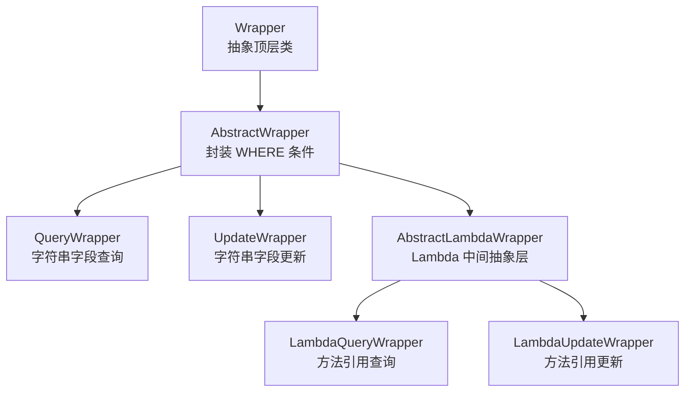
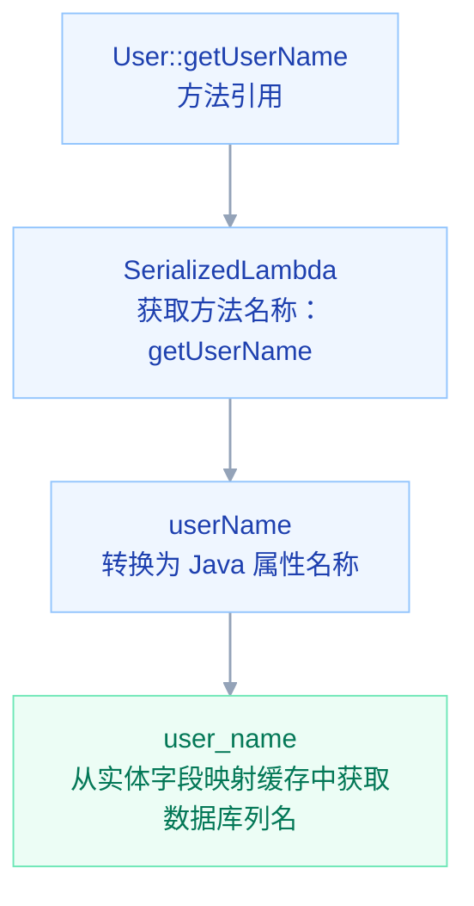

# 一、基于 `Mapper` 接口 `CRUD`

`MyBatis-Plus` 提供了 `BaseMapper<T>` 接口，封装了常用的单表 `CRUD` 方法。

只需要让自定义 `Mapper` 接口继承 `BaseMapper<T>`，并指定对应的实体类即可

1.   继承 `BaseMapper` 接口

     ```java
     @Mapper
     public interface UserInfoMapper extends BaseMapper<UserInfo> {
     }
     ```

     `BaseMapper`：`MyBatis-Plus` 提供的基础 `Mapper` 接口

     `UserInfo`：当前 `Mapper` 对应的实体类

     `@Mapper`：将 `Mapper` 接口注册为 `MyBatis Mapper`

2.   常用 `CRUD` 方法

     `BaseMapper` 提供了以下常用方法：

     | 方法                      | 作用                 |
     | ------------------------- | -------------------- |
     | `insert(entity)`          | 插入一条记录         |
     | `deleteById(id)`          | 根据主键删除         |
     | `deleteByIds(ids)`        | 根据多个主键批量删除 |
     | `deleteByMap(map)`        | 根据 Map 条件删除    |
     | `delete(wrapper)`         | 根据条件删除         |
     | `updateById(entity)`      | 根据主键修改         |
     | `update(entity, wrapper)` | 根据条件修改         |
     | `selectById(id)`          | 根据主键查询         |
     | `selectBatchIds(ids)`     | 根据多个主键批量查询 |
     | `selectByMap(map)`        | 根据 Map 条件查询    |
     | `selectOne(wrapper)`      | 根据条件查询一条记录 |
     | `selectList(wrapper)`     | 根据条件查询多条记录 |
     | `selectCount(wrapper)`    | 根据条件统计记录数   |
     | `selectMaps(wrapper)`     | 查询结果封装为 Map   |
     | `selectObjs(wrapper)`     | 查询结果返回对象列表 |


## 1.1 使用示例

### 1.1.1 简单条件

1.   新增

     ```java
     UserInfo userInfo = new UserInfo();
     userInfo.setUserName("bin");
     userInfo.setRealName("张三");
     userInfo.setStatus(1);
     
     userInfoMapper.insert(userInfo);
     ```

2.   根据主键查询

     ```java
     UserInfo userInfo = userInfoMapper.selectById(1L);
     ```

3.   根据主键修改

     ```java
     UserInfo userInfo = new UserInfo();
     userInfo.setUserId(1L);
     userInfo.setRealName("李四");
     
     userInfoMapper.updateById(userInfo);
     ```

4.   根据主键删除

     ```java
     userInfoMapper.deleteById(1L);
     ```


### 1.1.2 `Map` 条件

1.   根据条件查询

     ```java
     Map<String, Object> map = new HashMap<>();
     map.put("user_name", "bin");
     map.put("status", 1);
     
     List<UserInfo> userList = userInfoMapper.selectByMap(map);
     ```

2.   根据条件删除

     ```java
     Map<String, Object> map = new HashMap<>();
     map.put("user_name", "bin");
     
     userInfoMapper.deleteByMap(map);
     ```


### 1.1.3 `Wrapper` 条件构造器

`Wrapper` 是 `MyBatis-Plus` 提供的条件构造器，可以动态构建 `SQL` 查询、修改和删除条件

```java
// 这俩玩意是 MyBatis Plus 提供的

import com.baomidou.mybatisplus.core.conditions.query.LambdaQueryWrapper;
import com.baomidou.mybatisplus.core.conditions.query.QueryWrapper;
```

1.   条件查询 `selectList`

     ```java
     QueryWrapper<UserInfo> wrapper = new QueryWrapper<>();
     
     // user_name 是数据库字段名
     wrapper.eq("user_name", "bin")
            .eq("status", 1);
     
     List<UserInfo> userList = userInfoMapper.selectList(wrapper);
     ```

     ```sql
     SELECT *
     FROM user_info
     WHERE user_name = 'bin' AND status = 1;
     ```

2.   条件查询单条记录 `selectOne`

     ```java
     QueryWrapper<UserInfo> wrapper = new QueryWrapper<>();
     
     // user_name 是数据库字段名
     wrapper.eq("user_name", "bin");
     
     UserInfo userInfo = userInfoMapper.selectOne(wrapper);
     ```

     >   注意：`selectOne` 查询结果必须最多只有一条记录，否则会抛出异常

3.   条件修改 `update`

     ```java
     UserInfo userInfo = new UserInfo();
     userInfo.setStatus(0);
     
     QueryWrapper<UserInfo> wrapper = new QueryWrapper<>();
     // user_name 是数据库字段名
     wrapper.eq("user_name", "bin");
     
     userInfoMapper.update(userInfo, wrapper);
     ```

     ```sql
     UPDATE user_info
     SET status = 0
     WHERE user_name = 'bin';
     ```

     >   `wrapper` 条件为 `null` 会删除全部
     >
     >   `update(entity, wrapper)`：当实体类中属性值为 `null` 时不修改。`int` 的默认值为0，容易造成误修改。所以实体类中的数据库字段优先使用包装类型（如 `Integer`、`Long`、`Boolean`）

4.   条件删除 `delete`

     ```java
     QueryWrapper<UserInfo> wrapper = new QueryWrapper<>();
     wrapper.eq("user_name", "bin");
     
     userInfoMapper.delete(wrapper);
     ```

     ```sql
     DELETE FROM user_info
     WHERE user_name = 'bin';
     ```
     
     如果条件为空则删除全表，注意注意注意！！！
     
     ```java
     QueryWrapper<UserInfo> wrapper = new QueryWrapper<>();
     
     userInfoMapper.delete(wrapper);
     ```
     
     ```sql
     DELETE FROM user_info;
     ```
     
     


## 1.2 分页查询

[MybatisPlus 分页插件](https://baomidou.com/plugins/pagination/ "MybatisPlus 分页插件")

### 1.2.1 使用分页插件

>   `xml` 的 `sql` 语句不要以 `;` 结尾，原理就是在 `sql` 语句后面追加 `LIMIT`

1.   创建配置类

     ```java
     @Configuration
     public class MybatisPlusConfig {
     
         @Bean
         public MybatisPlusInterceptor mybatisPlusInterceptor() {
     
             // 定义 MybatisPlus 的插件集合
             MybatisPlusInterceptor interceptor = new MybatisPlusInterceptor();
     
             // 添加分页拦截器
             interceptor.addInnerInterceptor(new PaginationInnerInterceptor(DbType.MYSQL));
     
             return interceptor;
         }
     }
     ```

2.   使用

     ```java
     Page<UserInfo> page = new Page<>(1, 10);
     
     Page<UserInfo> result = userInfoMapper.selectPage(
         page,
         new LambdaQueryWrapper<UserInfo>()
             .eq(UserInfo::getStatus, 1)
     );
     ```

3.   分页结果常用属性：

     | 属性           | 作用       |
     | -------------- | ---------- |
     | `getCurrent()` | 当前页     |
     | `getSize()`    | 每页条数   |
     | `getTotal()`   | 总记录数   |
     | `getPages()`   | 总页数     |
     | `getRecords()` | 当前页数据 |


#### 自定义 `Mapper` 方法中使用分页

1.   `xml`

     ```xml
     <mapper namespace="com.springboot2.mapper.UserInfoMapper">
     
         <select id="selectUserPage" resultType="com.springboot2.entity.UserInfo">
             SELECT *
             FROM user_info
             WHERE age > #{age}
         </select>
     
     </mapper>
     ```

2.   `mapper`

     ```java
     @Mapper
     public interface UserInfoMapper extends BaseMapper<UserInfo> {
     
         /**
          * 根据年龄分页查询用户
          */
         IPage<UserInfo> selectUserPage(
                 IPage<UserInfo> page,
                 @Param("age") Integer age
         );
     
     }
     ```

     >   传入 `Page`，插件自动处理分页 `SQL` 和总数查询

     -   `IPage<UserInfo>`：分页参数，同时用于接收分页结果。
     -   `@Param("age")`：普通查询参数，供 XML 使用

3.   `Service` 调用

     ```java
     @Service
     public class UserInfoServiceImpl
             extends ServiceImpl<UserInfoMapper, UserInfo>
             implements UserInfoService {
     
         @Override
         public IPage<UserInfo> selectUserPage(Integer current, Integer size, Integer age) {
     
             // 创建分页对象
             Page<UserInfo> page = new Page<>(current, size);
     
             // 调用自定义分页方法
             return baseMapper.selectUserPage(page, age);
         }
     }
     ```


### 1.2.2 不使用分页插件

1.   `xml`

     ```xml
     <select id="selectUserPage" resultType="com.springboot2.entity.UserInfo">
         SELECT *
         FROM user_info
         WHERE status = #{status}
         LIMIT #{page.offset}, #{page.size}
     </select>
     ```

2.   `mapper`

     ```java
     @Mapper
     public interface UserInfoMapper extends BaseMapper<UserInfo> {
     
         /**
          * 分页查询用户
          */
         IPage<UserInfo> selectUserPage(
                 IPage<UserInfo> page,
                 @Param("status") Integer status
         );
     }
     ```

3.   `service` 调用

     ```java
     IPage<UserInfo> page = new Page<>(1, 10);
     
     IPage<UserInfo> result = userInfoMapper.selectUserPage(page, 1);
     ```

4.   如果需要获取**总记录数**，还需要额外执行 `COUNT` 查询

     ```java
     page.setTotal(userInfoMapper.selectCount(
             new LambdaQueryWrapper<UserInfo>()
                     .eq(UserInfo::getStatus, 1)
     ));
     ```


# 二、基于 `Service` 接口 `CRUD`

`MyBatis-Plus` 除了提供 `BaseMapper` 实现基础 `CRUD`，还提供了 `IService` 接口和 `ServiceImpl` 实现类，进一步封装了 `Service` 层常用的 `CRUD` 操作

相比直接使用 `Mapper`，`Service` 层提供了更多业务开发常用的方法，例如批量新增、批量修改、批量保存或更新等

1.   继承 `IService` 接口，并继承 `ServiceImpl<M, T>` 子类（`MyBatis-Plus` 提供 `ServiceImpl<M, T>` 实现类，可以**直接实现 `IService` 中定义的方法**）

     泛型说明：

     -   `M`：`Mapper` 接口类型
     -   `T`：实体类类型

     ```java
     // MyBatis-Plus 提供 IService<T> 接口，需要指定对应的实体类
     public interface UserInfoService extends IService<UserInfo> {
         
     }
     ```

     ```java
     @Service
     public class UserInfoServiceImpl
             extends ServiceImpl<UserInfoMapper, UserInfo>      // 继承 ServiceImpl<UserInfoMapper, UserInfo> 类，用来实现 IService 接口
             implements UserInfoService {
     
     }
     ```
     
     >   这里的 `UserInfoMapper` 必须继承 `BaseMapper<UserInfo>`
     
1.   常用 `CRUD` 方法

     `IService` 提供了以下常用方法：

     | 方法                      | 作用                                                         |
     | ------------------------- | ------------------------------------------------------------ |
     | `save(entity)`            | 新增一条记录                                                 |
     | `saveBatch(list)`         | 批量新增                                                     |
     | `saveOrUpdate(entity)`    | 根据主键判断新增或修改<br />主键为 `null` 是插入，主键有值是更新 |
     | `saveOrUpdateBatch(list)` | 批量新增或修改                                               |
     | `removeById(id)`          | 根据主键删除                                                 |
     | `removeByIds(ids)`        | 根据多个主键删除                                             |
     | `removeByMap(map)`        | 根据 Map 条件删除                                            |
     | `remove(wrapper)`         | 根据条件删除                                                 |
     | `updateById(entity)`      | 根据主键修改                                                 |
     | `update(entity, wrapper)` | 根据条件修改                                                 |
     | `updateBatchById(list)`   | 批量修改                                                     |
     | `getById(id)`             | 根据主键查询                                                 |
     | `getOne(wrapper)`         | 根据条件查询一条记录                                         |
     | `listByIds(ids)`          | 根据多个主键查询                                             |
     | `listByMap(map)`          | 根据 Map 条件查询                                            |
     | `list(wrapper)`           | 根据条件查询多条记录                                         |
     | `count(wrapper)`          | 根据条件统计记录数                                           |
     | `page(page, wrapper)`     | 分页查询                                                     |


## 2.1 使用示例

### 2.1.1 `save` 新增

1.   新增

     ```java
     @RestController
     @RequestMapping("/user")
     public class UserInfoController {
     
         private final UserInfoService userInfoService;
     
         public UserInfoController(UserInfoService userInfoService) {
             this.userInfoService = userInfoService;
         }
         
         // 保存
         public void saveUserInfo() {
             UserInfo userInfo = new UserInfo();
             userInfo.setUserName("bin");
             userInfo.setRealName("张三");
     
             userInfoService.save(userInfo);
         }
     
     }
     ```

2.   批量新增

     ```java
     List<UserInfo> userList = new ArrayList<>();
     
     userList.add(user1);
     userList.add(user2);
     
     userInfoService.saveBatch(userList);
     ```


### 2.1.2 根据主键查询

```java
UserInfo userInfo = userInfoService.getById(1L);
```


### 2.1.3 `update` 修改

1.   根据主键修改

     ```java
     UserInfo userInfo = new UserInfo();
     userInfo.setUserId(1L);
     userInfo.setRealName("李四");
     
     userInfoService.updateById(userInfo);
     ```

2.   `update(entity, wrapper)`  根据条件修改

     ```java
     // 将用户名为 bin 的用户状态修改为禁用
     UserInfo userInfo = new UserInfo();
     userInfo.setStatus(0);
     
     LambdaQueryWrapper<UserInfo> wrapper = new LambdaQueryWrapper<>();
     
     wrapper.eq(UserInfo::getUserName, "bin");
     
     userInfoService.update(userInfo, wrapper);
     ```

     ```sql
     UPDATE user_info
     SET status = 0
     WHERE user_name = 'bin';
     ```


### 2.1.4 根据主键删除

```java
userInfoService.removeById(1L);
```


# 三、条件构造器

>   `MyBatis-Plus` 提供了一套强大的条件构造器（`Wrapper`），用于构建复杂的数据库查询条件

[Wrapper 条件构造器](https://baomidou.com/guides/wrapper/ "wrapper")



| 对比项       | `QueryWrapper` | `UpdateWrapper` | `LambdaQueryWrapper` | `LambdaUpdateWrapper` |
| ------------ | -------------- | --------------- | -------------------- | --------------------- |
| 查询条件     | 支持           | 支持            | 支持                 | 支持                  |
| 更新字段     | 不支持         | 支持            | 不支持               | 支持                  |
| 排序分组     | 支持           | 支持            | 支持                 | 支持                  |
| 条件组合     | 支持           | 支持            | 支持                 | 支持                  |
| 字段指定方式 | 字符串         | 字符串          | `Lambda` 方法引用    | `Lambda` 方法引用     |


## 3.1 `AbstractWrapper`

**`AbstractWrapper`**：这是一个抽象基类，提供了所有 `Wrapper` 类共有的方法和属性。它定义了条件构造的基本逻辑，包括字段（`column`）、值（`value`）、操作符（`condition`）等。所有的 `QueryWrapper`、`UpdateWrapper`、`LambdaQueryWrapper` 和 `LambdaUpdateWrapper` 都继承自 `AbstractWrapper`

| 类型                     | 主要用途     | 字段指定方式       |
| ------------------------ | ------------ | ------------------ |
| `QueryWrapper<T>`        | 查询条件构造 | 数据库字段名字符串 |
| `UpdateWrapper<T>`       | 更新条件构造 | 数据库字段名字符串 |
| `LambdaQueryWrapper<T>`  | 查询条件构造 | 实体类方法引用     |
| `LambdaUpdateWrapper<T>` | 更新条件构造 | 实体类方法引用     |

1.   查询条件

     | 方法         | `SQL` 对应关系    | 作用                 |
     | ------------ | ----------------- | -------------------- |
     | `eq`         | `=`               | 等于                 |
     | `ne`         | `<>`              | 不等于               |
     | `gt`         | `>`               | 大于                 |
     | `ge`         | `>=`              | 大于等于             |
     | `lt`         | `<`               | 小于                 |
     | `le`         | `<=`              | 小于等于             |
     | `between`    | `BETWEEN AND`     | 区间查询，包含两端   |
     | `notBetween` | `NOT BETWEEN AND` | 不在指定区间         |
     | `like`       | `LIKE '%值%'`     | 两侧模糊查询         |
     | `likeLeft`   | `LIKE '%值'`      | 左模糊查询           |
     | `likeRight`  | `LIKE '值%'`      | 右模糊查询           |
     | `notLike`    | `NOT LIKE`        | 不包含指定内容       |
     | `in`         | `IN`              | 包含指定集合中的值   |
     | `notIn`      | `NOT IN`          | 不包含指定集合中的值 |
     | `isNull`     | `IS NULL`         | 判断字段为空         |
     | `isNotNull`  | `IS NOT NULL`     | 判断字段不为空       |

2.   条件组合

     | 方法        | SQL 对应关系 | 作用                     |
     | ----------- | ------------ | ------------------------ |
     | `and`       | `AND`        | `AND` 条件组合           |
     | `or`        | `OR`         | `OR` 条件组合            |
     | `nested`    | `(条件)`     | 嵌套条件，不指定连接方式 |
     | `exists`    | `EXISTS`     | 存在子查询条件           |
     | `notExists` | `NOT EXISTS` | 不存在子查询条件         |

3.   排序与分组

     | 方法          | SQL 对应关系        | 作用           |
     | ------------- | ------------------- | -------------- |
     | `orderByAsc`  | `ORDER BY ... ASC`  | 升序排序       |
     | `orderByDesc` | `ORDER BY ... DESC` | 降序排序       |
     | `orderBy`     | `ORDER BY`          | 自定义排序方向 |
     | `groupBy`     | `GROUP BY`          | 分组查询       |
     | `having`      | `HAVING`            | 分组后过滤     |

4.   其他常用方法

     | 方法      | 作用                                      |      |
     | --------- | ----------------------------------------- | ---- |
     | `apply`   | 拼接自定义 `SQL` 条件片段，支持参数占位符 |      |
     | `last`    | 在 `SQL` 最后追加自定义 `SQL` 片段        |      |
     | `comment` | 添加 `SQL` 注释                           |      |
     | `first`   | 在 `SQL` 语句最前面添加 `SQL` 片段        |      |
     | `func`    | 执行自定义条件构造逻辑                    |      |
     | `clear`   | 清空当前 `Wrapper` 中的条件               |      |


## 3.2 `QueryWrapper`

1.   基础条件查询

     ```java
     QueryWrapper<User> queryWrapper = new QueryWrapper<>();
     
     // 条件之间默认使用 AND 拼接
     queryWrapper
             .eq("status", 1)
             .gt("age", 18)
             .between("age", 20, 30);
     
     List<User> list = userMapper.selectList(queryWrapper);
     ```

     ```sql
     SELECT *
     FROM user
     WHERE status = 1
       AND age > 18
       AND age BETWEEN 20 AND 30;
     ```

2.   集合与 `NULL` 查询

     ```java
     QueryWrapper<User> queryWrapper = new QueryWrapper<>();
     
     queryWrapper
             .in("status", Arrays.asList(1, 2))
             .notIn("id", Arrays.asList(3, 4))
             .isNotNull("email");
     ```

     ```sql
     SELECT *
     FROM user
     WHERE status IN (1, 2)
       AND id NOT IN (3, 4)
       AND email IS NOT NULL;
     ```

3.   条件组合

     ```java
     QueryWrapper<User> queryWrapper = new QueryWrapper<>();
     
     queryWrapper
             .eq("status", 1)
             .and(wrapper -> wrapper
                     .lt("age", 18)
                     .or()
                     .gt("age", 60)
             );
     ```

     ```sql
     SELECT *
     FROM user
     WHERE status = 1
       AND (age < 18 OR age > 60);
     ```

4.   排序与分组

     ```java
     QueryWrapper<User> queryWrapper = new QueryWrapper<>();
     
     queryWrapper
             .select("status", "COUNT(*) AS total")
             .groupBy("status")
             .having("COUNT(*) > {0}", 5)
             .orderByDesc("total");
     ```

     ```sql
     SELECT status, COUNT(*) AS total
     FROM user
     GROUP BY status
     HAVING COUNT(*) > 5
     ORDER BY total DESC;
     ```

5.   动态条件查询

     每个方法都会有个 `boolean condition`，允许我们放一个比较表达式

     只有条件为 `true` 时，才会添加对应的 `SQL` 查询条件

     ```java
     Integer age = 20;
     String username = "bin";
     
     QueryWrapper<User> queryWrapper = new QueryWrapper<>();
     
     queryWrapper
             .eq(age != null, "age", age)
             .like(username != null && !username.isEmpty(), "username", username);
     
     List<User> list = userMapper.selectList(queryWrapper);
     ```


## 3.3 `UpdateWrapper`

使用 `set` 指定需要更新的字段和值

1.   设置更新字段和值

     ```java
     UpdateWrapper<User> updateWrapper = new UpdateWrapper<>();
     
     updateWrapper
             .set("status", 0)
         	// 可以设置 null 值（update(entity, wrapper) entity 属性值为 null 时会忽略更新）
         	.set("email", null)
             .eq("username", "bin");
     
     userMapper.update(null, updateWrapper);
     ```

     ```sql
     UPDATE user
     SET status = 0,
         email = NULL
     WHERE username = 'bin';
     ```

2.   使用实体对象更新

     ```java
     UpdateWrapper<User> updateWrapper = new UpdateWrapper<>();
     
     updateWrapper.eq("username", "bin");
     
     User user = new User();
     user.setStatus(0);
     user.setAge(25);
     
     userMapper.update(user, updateWrapper);
     ```

     ```sql
     UPDATE user
     SET status = 0,
         age = 25
     WHERE username = 'bin';
     ```

3.   使用 `setSql` 自定义更新 `SQL`

     ```java
     UpdateWrapper<User> updateWrapper = new UpdateWrapper<>();
     
     updateWrapper
             .setSql("age = age + 1")
             .eq("username", "bin");
     
     userMapper.update(null, updateWrapper);
     ```

     ```sql
     UPDATE user
     SET age = age + 1
     WHERE username = 'bin';
     ```


## 3.4 `AbstractLambdaWrapper`

供 `Lambda` 条件构造器的基础实现，支持通过实体类的方法引用指定数据库字段，避免手动填写字段名

```java
queryWrapper.eq(User::getUserName, "bin");
```

实现原理：

1.   利用 `SerializedLambda` 获取方法引用的方法名称（`getUserName`）
2.   将方法名称转换为 `Java` 属性名称（`userName`）
3.   通过实体类属性与数据库字段的映射缓存（`ColumnCache`），获取对应的数据库字段名

整个过程不需要真正调用 `getUserName()` 方法获取用户数据




### 3.4.1 `LambdaQueryWrapper`

1.   简单条件查询

     ```java
     LambdaQueryWrapper<User> queryWrapper = new LambdaQueryWrapper<>();
     
     queryWrapper
             .like(User::getUserName, "a")
             .between(User::getAge, 20, 30)
             .isNotNull(User::getEmail);
     
     List<User> list = userMapper.selectList(queryWrapper);
     ```

     ```sql
     SELECT *
     FROM user
     WHERE user_name LIKE '%a%'
       AND age BETWEEN 20 AND 30
       AND email IS NOT NULL;
     ```

2.   多条件组合查询

     ```java
     LambdaQueryWrapper<User> queryWrapper = new LambdaQueryWrapper<>();
     
     queryWrapper
             .eq(User::getStatus, 1)
             .and(wrapper -> wrapper
                     .lt(User::getAge, 18)
                     .or()
                     .gt(User::getAge, 60)
             );
     
     List<User> list = userMapper.selectList(queryWrapper);
     ```

     ```sql
     SELECT *
     FROM user
     WHERE status = 1
       AND (age < 18 OR age > 60);
     ```

3.   排序查询

     ```java
     LambdaQueryWrapper<User> queryWrapper = new LambdaQueryWrapper<>();
     
     queryWrapper
             .eq(User::getStatus, 1)
             .orderByDesc(User::getAge)
             .orderByAsc(User::getId);
     
     List<User> list = userMapper.selectList(queryWrapper);
     ```

     ```sql
     SELECT *
     FROM user
     WHERE status = 1
     ORDER BY age DESC, id ASC;
     ```

4.   动态条件查询

     ```java
     Integer age = 20;
     String userName = "bin";
     
     LambdaQueryWrapper<User> queryWrapper = new LambdaQueryWrapper<>();
     
     queryWrapper
             .eq(age != null, User::getAge, age)
             .like(userName != null && !userName.isEmpty(),
                     User::getUserName, userName);
     
     List<User> list = userMapper.selectList(queryWrapper);
     ```

     如果 `age` 或 `userName` 为空，则对应条件不会被添加


### 3.4.2 `LambdaUpdateWrapper`

1.   使用 `set` 设置更新字段和值

     ```java
     LambdaUpdateWrapper<User> updateWrapper = new LambdaUpdateWrapper<>();
     
     updateWrapper
             .set(User::getStatus, 0)
             .eq(User::getUsername, "bin");
     
     userMapper.update(null, updateWrapper);
     ```

     ```sql
     UPDATE user
     SET status = 0
     WHERE username = 'bin';
     ```

2.   使用实体对象更新

     ```java
     LambdaUpdateWrapper<User> updateWrapper = new LambdaUpdateWrapper<>();
     
     updateWrapper.eq(User::getUsername, "bin");
     
     User user = new User();
     user.setStatus(0);
     user.setAge(25);
     
     userMapper.update(user, updateWrapper);
     ```

     ```sql
     UPDATE user
     SET status = 0,
         age = 25
     WHERE username = 'bin';
     ```

3.   使用 `setSql` 自定义更新 `SQL`

     ```java
     LambdaUpdateWrapper<User> updateWrapper = new LambdaUpdateWrapper<>();
     
     updateWrapper
             .setSql("age = age + 1")
             .eq(User::getUsername, "bin");
      
     userMapper.update(null, updateWrapper);
     ```

     ```sql
     UPDATE user
     SET age = age + 1
     WHERE username = 'bin';
     ```

4.   动态更新条件

     ```java
     LambdaUpdateWrapper<User> updateWrapper = new LambdaUpdateWrapper<>();
     
     updateWrapper
             .set(User::getStatus, 0)
             .eq(User::getId, 1L)
             .eq(User::getAge, 20);
     ```

     
