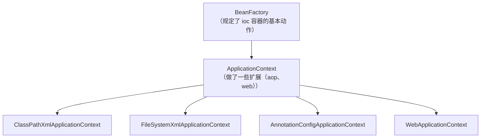

# 一、`Spring`

[`Spring` 官网](https://spring.io "spring")

`Spring` 的概念：

-   广义的 `Spring`：`Spring` 技术栈（全家桶）
-   狭义的 `Spring`：`Spring Framework` 基础框架

`Spring` 不仅仅是一个框架，更是一个庞大的生态家族。通常说的 `Spring` 可能指代整个项目家族（如 `Spring Boot`、`Spring Security`、`Spring Data`、`Spring Cloud` 等）


# 二、`Spring Framework` 基础框架

[Spring Framework 官网](https://spring.io/projects/spring-framework "Spring Framework")

`Spring Framework` 是一个开源的 `Java` 企业级应用开发框架，核心目标是简化 `Java EE` 开发的复杂性。它通过依赖注入（`DI`）和面向切面编程（`AOP`）等机制，让开发者专注于业务逻辑，而不必被底层基础设施的“管道”工作所牵绊


## 2.1 `Spring Framework` 主要功能模块：

| 功能模块         | 功能介绍                                                     |
| ---------------- | ------------------------------------------------------------ |
| `Core Container` | 核心容器，在 `Spring` 环境下使用任何功能都必须基于 `IOC` 容器 |
| `AOP & Aspects`  | 面向切面编程                                                 |
| `TX`             | 声明式事务管理                                               |
| `Spring MVC`     | 提供了面向 `Web`应用程序的集成功能                           |

`Spring Framework` 的三个核心功能：

1. 组件管理：`IoC` 和 `DI`

2. `AOP`（`Aspect Oriented Programming`，面向切面编程）

    面向切面，在不修改原有业务代码的前提下，对方法做增强（日志、事务、权限、监控等），把通用横切逻辑抽离成切面

3. 事务管理（`Transaction Management`）

    提供**声明式事务**、编程式事务，统一管理数据库事务，简化事务代码，支持不同事务策略，`@Transactional`就是最常用的声明式事务


## 2.2 `Spring Framework` 的优势

1.   丰富的生态

     `Spring` 早已不只是一个框架，而是一个覆盖企业开发各个层面的项目家族。除了核心的 `Spring Framework`，还有简化配置与部署的 **`Spring Boot`**、负责安全的 **`Spring Security`**、统一数据访问的 **`Spring Data`**、以及微服务治理的 **`Spring Cloud`**

2.   模块化设计

     `Spring Framework` 本身被划分为多个模块，应用可以**只选择自己需要的部分**，而不必引入整个框架。核心是包含配置模型和依赖注入机制的容器模块，之上还有支持消息、事务、持久化、`Web`（`Spring MVC` 与 `WebFlux`）等不同架构的模块

3.   简化 `Java` 开发

     这是 `IoC/DI` 和 `AOP` 带来的直接结果。`Spring` 官方将其概括为让 `Java` 编程**更快、更简单、更安全**。具体到开发体验上：`IoC` 容器接管了对象的创建与依赖装配，你不再需要手动处理单例、属性文件解析等“管道”工作，可以专注于业务逻辑；`AOP` 把日志、事务等横切逻辑从业务代码中剥离，声明式事务让你加个注解就能获得事务能力

4.   不断创新和发展


## 2.3 `Spring Framework` 与 `Spring ` 的关系

| 术语               | 指代范围     | 关系                                                   |
| :----------------- | :----------- | :----------------------------------------------------- |
| `Spring`           | 整个生态家族 | 包含` Spring Framework` 以及建立在它之上的众多子项目   |
| `Spring Framework` | 基础框架本身 | 是家族中**最核心、最底层**的项目，其他项目都以它为基础 |

具体来说，`Spring Framework` 提供了依赖注入（`IoC`）、`AOP`、事务管理、`Web` 支持等**核心基础能力**。而 `Spring Boot`、`Spring Security`、`Spring Data`、`Spring Cloud` 等项目，都是在 `Spring Framework` 的基础之上构建的，各自解决特定领域的问题（如简化配置、安全、数据访问、微服务治理）。这些项目各有独立的代码库和发布节奏，共同构成了 `Spring` 这个大家庭


# 三、`SpringIoC` 容器和核心概念

## 3.1 组件的概念

组件的概念：组件就是可复用的 **`Java` 对象**，`Spring` 则充当组件管理角色

>   所以组件一定是对象，但是对象不一定就是组件


**组件**可以完全交给 `Spring` 框架进行管理，`Spring` 框架替代了程序员原有的 `new` 对象和对象属性赋值动作等！

`Spring` 具体的组件管理动作包含：

1.  组件对象实例化
2.  组件属性属性赋值
3.  组件对象之间引用
4.   组件对象存活周期管理


### 3.1.1 为什么要使用组件？

如果有一个类，如果其他类需要使用它

```java
public class UserService {

    public void hello() {
        System.out.println("Hello");
    }
}
```

1. 先 `new` 再使用

    ```java
    public class Main {
    
        public static void main(String[] args) {
            UserService service = new UserService();
            service.hello();
        }
    }
    ```

2. 使用 `Bean` 之后，可以直接省去 `new` 的步骤，类的创建交由 `Spring IoC` 管理、创建

    ```java
    @Service    // UserService 对象将会交给 Spring 管理
    public class UserService {
    }
    ```

    ```java
    @RestController
    public class UserController {
    
        // 自动装配，不再需要 new
        @Autowired
        private UserService userService;
    }
    ```


### 3.1.2 组件交给 `Spring` 管理的优势

为什么不直接 `new`，而是要交给 `Spring` 管理呢？

1.   解耦与集中管理
2.   提高代码的可重用性和可维护性
3.   方便配置和管理
4.   交给 `Spring` 管理的对象（组件），方可享受 `Spring` 框架的其他功能（`AOP`，声明事务管理）等


## 3.2 `SpringIoC` 容器和容器实现


### 3.2.1 `SpringIoC` 容器介绍

`Spring IoC` 容器，负责实例化、配置和组装 `bean` （组件）。容器通过读取配置元数据来获取有关要实例化、配置和组装组件的指令

配置元数据以 `XML`、`Java` 注解或 `Java` 代码形式表现。它允许表达组成应用程序的组件以及这些组件之间丰富的相互依赖关系


### 3.2.2 `SpringIoc` 容器具体接口和实现类

-   `BeanFactory` 接口提供了一种高级配置机制，能够管理任何类型的对象，它是 `SpringIoC` 容器标准化超接口
-   `ApplicationContext` 是 `BeanFactory` 的子接口。它**扩展**了以下功能：
    1.   更容易与 `Spring` 的 `AOP` 功能集成
    2.   消息资源处理（用于国际化）
    3.   特定于应用程序给予此接口实现，例如 `Web` 应用程序的 `WebApplicationContext`

简而言之， `BeanFactory` 提供了配置框架和基本功能，而 `ApplicationContext` 添加了更多特定于企业的功能。 `ApplicationContext` 是 `BeanFactory` 的完整超集

---

`ApplicationContext` 容器实现类：

| 类型名                               | 简介                                                         |
| ------------------------------------ | ------------------------------------------------------------ |
| `ClassPathXmlApplicationContext`     | 通过读取类路径（`resources`）下的 `XML` 格式的配置文件创建 `IOC` 容器对象 |
| `FileSystemXmlApplicationContext`    | 通过文件**系统路径**读取 `XML` 格式的配置文件创建 `IOC` 容器对象 |
| `AnnotationConfigApplicationContext` | 通过读取`Java`配置类创建 `IOC` 容器对象                      |
| `WebApplicationContext`              | 专门为 `Web` 应用准备，基于 `Web` 环境创建 `IOC` 容器对象，并将对象引入存入 `ServletContext` 域中 |




### 3.2.3 `Spring IoC` 容器管理配置方式

`Spring` 框架提供了多种配置方式：**`XML` 配置方式**、**注解方式**和 **`Java` 配置类**方式

1. `XML` 配置方式：是 `Spring` 框架最早的配置方式之一，通过在 `XML` 文件中定义 `Bean` 及其依赖关系、`Bean` 的作用域等信息，让 `Spring IoC` 容器来管理 `Bean` 之间的依赖关系。该方式从 `Spring` 框架的第一版开始提供支持
2. 注解方式：从 `Spring 2.5` 版本开始提供支持，可以通过在 `Bean` 类上使用注解来代替 `XML` 配置文件中的配置信息。通过在 `Bean` 类上加上相应的注解（如 `@Component`, `@Service`, `@Autowired` 等），将`Bean` 注册到`Spring IoC` 容器中，这样 `Spring IoC` 容器就可以管理这些 `Bean` 之间的依赖关系
3. `Java` 配置类方式：`从Spring 3.0` 版本开始提供支持，通过 `Java` 类来定义 `Bean`、`Bean` 之间的依赖关系和配置信息，从而代替 `XML` 配置文件的方式。`Java`配置类是一种使用 `Java` 编写配置信息的方式，通过`@Configuration`、`@Bean` 等注解来实现 `Bean` ]和依赖关系的配置


## 3.3 `Spring IoC` / `DI` 概念

### 3.3.1 `Ioc(Inversion of Control)` 控制反转

`IoC` 主要是针对对象的创建和调用控制而言的，也就是说，当应用程序需要使用一个对象时，不再是应用程序直接创建该对象，而是由 `IoC` 容器来创建和管理，即控制权由应用程序转移到 `IoC` 容器中，也就是“反转”了控制权。这种方式基本上是通过依赖查找的方式来实现的，即 `loC` 容器维护着构成应用程序的对象，并负责创建这些对象。


### 3.3.2 `DI(Dependency Injection)` 依赖注入

`DI` 是指在组件之间传递依赖关系的过程中，将依赖关系在容器内部进行处理，这样就不必在应用程序代码中硬编码对象之间的依赖关系，实现了对象之间的解耦合。在 `Spring` 中，`DI` 是通过 `XML` 配置文件或注解的方式实现的。它提供了三种形式的依赖注入：构造函数注入、`Setter` 方法注入和接口注入。
