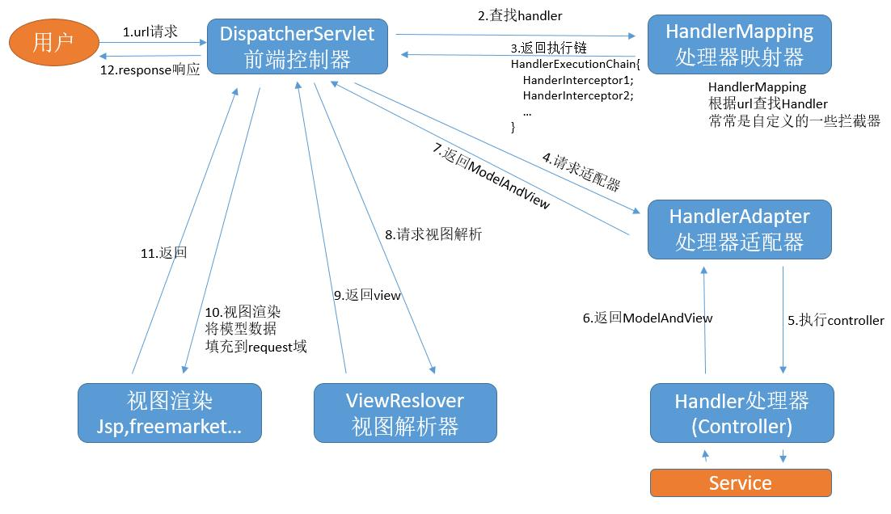

# 一、`Spring MVC` (`Spring Model View Controller`)

`Spring Web MVC` 是基于 `Servlet API` 构建的原始 `Web` 框架，从一开始就包含在 `Spring Framework` 中。正式名称“`Spring Web MVC`”来自其源模块的名称（ `spring-webmvc` ），但它通常被称为“`Spring MVC`”


## 1.1 `Spring MVC` 工作流程

```tex
客户端发送 HTTP 请求
        |
        v
DispatcherServlet（前端控制器）
        |
        v
HandlerMapping（处理器映射器）
        |
        v
找到对应的 Controller
        |
        v
HandlerInterceptor.preHandle()
        |
        +------ false ------> 请求结束
        |
        v
HandlerAdapter（处理器适配器）
        |
        v
执行 Controller 方法
        |
        v
HandlerInterceptor.postHandle()
        |
        v
View 渲染 / JSON 响应处理
        |
        v
HandlerInterceptor.afterCompletion()
        |
        v
    返回客户端
```




### 1.1.1 `DispatcherServlet` 前端控制器

>   前端控制器，统一接收和分发 `HTTP` 请求

`Spring MVC` 的总调度中心。所有请求都要经过它处理分发；请求进入 `Spring MVC` 后，`DispatcherServlet` 会想：这个请求应该交给哪个 `Controller`


### 1.1.2 `HandlerMapping` 处理器映射器

>   处理器映射器，根据请求找到对应的 `Controller` 方法

查找路由：`Spring` 会根据 **请求路径、请求方式** 查找对应的 `Controller`；`Spring` 会匹配 `@GetMapping("/{id}")`，也就是 `HandlerMapping`

```java
@RestController
@RequestMapping("/api/users")
public class UserController {

    @GetMapping("/{id}")
    public User getUser(@PathVariable Long id) {
        return new User();
    }
}
```


### 1.1.3 `Interceptor` 拦截器

`Interceptor` 主要有三个方法

1. `preHandle()`
2. `postHandle()`
3. `afterCompletion()`

| 方法                | 执行时机                            | 作用                         |
| ------------------- | ----------------------------------- | ---------------------------- |
| `preHandle()`       | `Controller` 执行之前               | 请求预处理，可以决定是否放行 |
| `postHandle()`      | `Controller` 执行之后，视图渲染之前 | 对 `ModelAndView` 进行处理   |
| `afterCompletion()` | 整个请求处理完成之后                | 资源清理、记录日志等         |

```tex
// 执行顺序
preHandle()
 ↓
Controller
 ↓
postHandle()
 ↓
afterCompletion()
```

```java
public class LoginInterceptor implements HandlerInterceptor {

    @Override
    public boolean preHandle(
            HttpServletRequest request,
            HttpServletResponse response,
            Object handler
    ) {
        System.out.println("Controller 执行之前");

        String token = request.getHeader("Authorization");

        if (token == null) {
            response.setStatus(401);
            // 返回 false 直接拦截，请求结束，不再往下执行 Controller
            return false;
        }

        return true;
    }
}
```

`Interceptor` 常见用途有：

1. 登录验证
2. 权限验证
3. `Token` 验证
4. 请求日志
5. 接口耗时统计


### 1.1.4 `HandlerAdapter`

>   处理器适配器，负责执行找到的 `Controller` 方法

根据 `Handler` 类型选择合适的 `HandlerAdapter`，由它去真正执行 `Handler`（如调用 `@RequestMapping` 标注的方法）


### 1.1.5 `Handler（Controller）` 处理器适配器

>   控制器，接收请求参数并处理请求

框架从请求里抠出 `@PathVariable `、`@RequestParam`、`@RequestBody` 塞进方法参数

1. `@PathVariable`：路径参数；如 `@GetMapping("/users/{id}")` 的 `id`
2. `@RequestParam`：请求参数；如 `/users?page=1&size=10` 的 `page` 和 `size`
3. `@RequestBody`：`JSON` 请求体；如 `@RequestBody User user`

```java
@RestController
@RequestMapping("/users")
public class UserController {
    
    @Autowired
    private UserService userService;

    @GetMapping("/{id}")
    public User getUser(@PathVariable Long id) {

        return userService.getUserById(id);
    }
}
```

`Controller` 的职责主要是：

1. 接收请求
2. 获取参数
3. 调用 `Service`
4. 返回结果

一般不建议在 `Controller` 写大量业务逻辑


## 1.2 `Spring MVC` 的依赖

1.   `SSM` 项目

     ```xml
     <!-- Spring MVC 核心；它会传递引入 spring-core、spring-beans、spring-context、spring-web 等基础模块 -->
     <dependency>
         <groupId>org.springframework</groupId>
         <artifactId>spring-webmvc</artifactId>
         <version>你的版本号</version>
     </dependency>
     
     <!-- Servlet API -->
     <dependency>
         <groupId>javax.servlet</groupId>
         <artifactId>javax.servlet-api</artifactId>
         <version>你的版本号</version>
         <scope>provided</scope>
     </dependency>
     
     <!-- JSON 处理（可选但常用） -->
     <dependency>
         <groupId>com.fasterxml.jackson.core</groupId>
         <artifactId>jackson-databind</artifactId>
         <version>你的版本号</version>
     </dependency>
     
     
     <!-- 校验注解（可选但常用） -->
     <dependency>
         <groupId>jakarta.platform</groupId>
         <artifactId>jakarta.jakartaee-web-api</artifactId>
         <version>9.1.0</version>
         <scope>provided</scope>
     </dependency>
             
     <!-- 校验注解实现（可选但常用） -->        
     <!-- https://mvnrepository.com/artifact/org.hibernate.validator/hibernate-validator -->
     <dependency>
         <groupId>org.hibernate.validator</groupId>
         <artifactId>hibernate-validator</artifactId>
         <version>8.0.0.Final</version>
     </dependency>
     
     <!-- 校验注解（可选但常用） -->
     <!-- https://mvnrepository.com/artifact/org.hibernate.validator/hibernate-validator-annotation-processor -->
     <dependency>
         <groupId>org.hibernate.validator</groupId>
         <artifactId>hibernate-validator-annotation-processor</artifactId>
         <version>8.0.0.Final</version>
     </dependency>
     ```

2.   `SpringBoot` 项目通常引入一个 `starter` 即可

     ```xml
     <dependency>
         <groupId>org.springframework.boot</groupId>
         <artifactId>spring-boot-starter-web</artifactId>
     </dependency>
     ```


# 二、启动 `Spring MVC`

1. 定义配置类（在 `Spring Boot` 中不需要配置这些了）

    ```java
    @Configuration
    @ComponentScan("com.springmvc")
    public class WebMvcConfig {
    
        @Bean
        public RequestMappingHandlerMapping handlerMapping() {
            return new RequestMappingHandlerMapping();
        }
    
        @Bean
        public RequestMappingHandlerAdapter handlerAdapter() {
            return new RequestMappingHandlerAdapter();
        }
    }
    
    // 或者使用 `@EnableWebMvc` 自动加入 handlerMapping、handlerAdapter，并且给 handlerAdapter 配置 json 处理器
    @EnableWebMvc                     // json数据处理，必须使用此注解，因为他会加入json处理器
    @Configuration
    @ComponentScan("com.springmvc")    // 配置包扫描
    public class WebMvcConfig implements WebMvcConfigurer {
    }
    ```

    ```java
    // TODO: SpringMVC 提供的接口，是替代 web.xml 的方案，更方便实现完全注解方式 ssm 处理!
    // TODO: Springmvc 框架会自动检查当前类的实现类，会自动加载 getRootConfigClasses / getServletConfigClasses 提供的配置类
    // TODO: getServletMappings 返回的地址 设置 DispatherServlet 对应处理的地址
    public class SpringMvcInit extends AbstractAnnotationConfigDispatcherServletInitializer {
    
        // 指定 root 容器配置类
        @Override
        protected Class<?>[] getRootConfigClasses() {
            return new Class[0];
        }
    
        // 指定 web 容器配置类
        @Override
        protected Class<?>[] getServletConfigClasses() {
            return new Class[]{WebMvcConfig.class};
        }
    
        // 指定 dispatcherServlet 处理路径
        @Override
        protected String[] getServletMappings() {
            return new String[]{"/"};
        }
    }
    ```

2. 定义 `Controller`

    ```java
    @Controller
    public class HelloController {
    
        // http://localhost:5000/springmvc/hello
        @RequestMapping("springmvc/hello")
        @ResponseBody
        public String hello() {
            System.out.println("Hello Controller");
            return "hello springmvc";
        }
    }
    ```

3. `Tomcat` 引入配置文件使用（需要 `Tomcat 10` 以上），配置 `Tomcat` 即可运行项目

    ```java
    // http://localhost:5000/springmvc/hello
    ```


