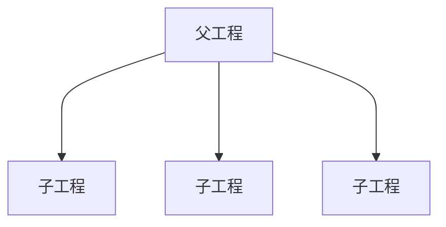

# 一、`SpringBoot2` 单模块项目的推荐目录结构

>   单模块多业务的拆分

```
my-project/
├── pom.xml
├── README.md
├── .editorconfig
├── .gitignore
│
├── docker/                         # Docker 相关配置
│   ├── Dockerfile                  # 可选：统一放在此处
│   └── docker-compose.yml          # 可选：容器编排
│
├── docs/                           # 项目文档
│   ├── database/                   # 数据库设计、DDL
│   ├── api/                        # 接口文档
│   └── deployment/                 # 部署文档
│
├── src/
│   ├── main/
│   │   ├── java/
│   │   │   └── com/example/project/
│   │   │       ├── ProjectApplication.java
│   │   │       │
│   │   │       ├── common/         # 公共基础设施
│   │   │       │   ├── annotation/ # 自定义注解
│   │   │       │   │   └── RequiresAuthentication.java
│   │   │       │   ├── constant/
│   │   │       │   ├── enums/
│   │   │       │   ├── exception/
│   │   │       │   ├── request/    # 公共请求
│   │   │       │   │   └── BaseRequest.java
│   │   │       │   ├── response/   # 公共返回参数
│   │   │       │   │   └── BaseResponse.java
│   │   │       │   └── util/       # 通用工具类
│   │   │       │   │   └── DateUtils.java
│   │   │       │
│   │   │       ├── config/         # 框架与基础设施配置
│   │   │       │   ├── MyBatisConfig.java
│   │   │       │   ├── WebConfig.java
│   │   │       │   └── JacksonConfig.java
│   │   │       │
│   │   │       ├── security/       # 认证与授权（按需）
│   │   │       │
│   │   │       ├── infrastructure/ # 外部系统与基础设施封装
│   │   │       │   ├── redis/
│   │   │       │   ├── mq/
│   │   │       │   └── client/
│   │   │       │
│   │   │       ├── modules/        # 业务模块
│   │   │       │   ├── user/
│   │   │       │   │   ├── convert/
│   │   │       │   │   ├── config/
│   │   │       │   │   ├── controller/
│   │   │       │   │   ├── service/
│   │   │       │   │   │   ├── UserService.java
│   │   │       │   │   │   └── impl/UserServiceImpl.java
│   │   │       │   │   ├── mapper/
│   │   │       │   │   ├── entity/
│   │   │       │   │   ├── dto/
│   │   │       │   │   ├── vo/
│   │   │       │   │   └── util/
│   │   │       │   ├── order/
│   │   │       │   ├── product/
│   │   │       │   └── payment/
│   │   │       │
│   │   │       └── job/            # 定时任务（按需）
│   │   │           ├── scheduled/
│   │   │           └── xxljob/
│   │   │
│   │   └── resources/
│   │       ├── application.yml
│   │       ├── application-dev.yml
│   │       ├── application-test.yml
│   │       ├── application-prod.yml
│   │       ├── mapper/             # MyBatis XML
│   │       ├── db/
│   │       │   └── migration/      # 数据库迁移脚本（按需）
│   │       └── logback-spring.xml
│   │
│   └── test/
│   │   ├── java/
│   │   │   └── com/example/project/
│   │   │   │   ├── module/
│   │   │   │   │   └── user/
│   │   │   │   │       ├── UserServiceTest.java
│   │   │   │   │       └── UserControllerTest.java
│   │   │   │   └── MyProjectApplicationTests.java
│   │   └── resources/
│
└── scripts/                        # 部署、运维脚本（按需）
```


## 业务模块内部的划分

```
modules/
└── order/
    ├── controller/
    │   └── OrderController.java
    │
    ├── service/
    │   ├── OrderService.java
    │   └── impl/
    │       └── OrderServiceImpl.java
    │
    ├── mapper/
    │   └── OrderMapper.java
    │
    ├── entity/                     # 数据库实体映射
    │   └── Order.java
    │
    ├── dto/                        # 接收请求参数、传递输入数据
    │   ├── OrderCreateDTO.java
    │   └── OrderQueryDTO.java
    │
    ├── vo/                         # 定义接口返回的数据结构
    │   └── OrderDetailVO.java
    │
    ├── assembler/                  # 不同对象之间的转换
    │   └── OrderAssembler.java
    │
    ├── processor/                  # 业务数据加工（按需）
    │   └── OrderResultProcessor.java
    │
    ├── client/                     # 调用其他系统（按需）
    │   └── OrderPaymentClient.java
    │
    └── enums/
    │   └── OrderStatus.java
    │
    └── util/                        # 业务专属工具类
```

| 目录           | 职责                                                        | 典型内容               |
| -------------- | ----------------------------------------------------------- | ---------------------- |
| `controller`   | 接收 `HTTP` 请求、参数校验、组织响应                        | `OrderController`      |
| `service`      | 定义业务服务接口                                            | `OrderService`         |
| `service/impl` | 实现业务流程、事务控制                                      | `OrderServiceImpl`     |
| `mapper`       | 数据库访问                                                  | `OrderMapper`          |
| `entity`       | 数据库实体映射                                              | `Order`                |
| `dto`          | `Data Transfer Object` <br />接收**请求参数**、传递输入数据 | `OrderCreateDTO`       |
| `vo`           | `View Object`（视图对象）<br />定义**接口返回**的数据结构   | `OrderDetailVO`        |
| `assembler`    | 不同对象之间的转换                                          | `Entity` 转 `VO`       |
| `processor`    | 特定业务场景的数据加工、结果处理                            | `OrderResultProcessor` |
| `client`       | 封装对其他服务或系统的调用                                  | 支付系统客户端         |
| `enums`        | 模块专属的枚举                                              | `OrderStatus`          |
| `util`         | 提供无业务关联辅助方法<br />如格式转换、字段处理、简单计算  | `OrderUtils`           |


# 二、`SpringBoot2` 多模块项目的推荐目录结构

>   多模块：对一个比较大型的项目进行了模块拆分



1.   父工程不写任何代码，只进行统一管理项目中的依赖信息，统一版本管理

2.   父工程只有一个 `pom.xml` 文件，父工程 `pom.xml` 的打包方式需要配置为 `pom`

     >   父工程也有 `.gitignore` 文件，毕竟 `git` 相关的还是要放在外层统一管理的
     >
     >   也可以有 `README.md` 等与工程无关的文件，一句话，父工程只做管理，没有逻辑

     ```xml
     <packaging>pom</packaging>
     ```

3.   父工程中需要引入各个子模块

     ```xml
     <!-- spring-boot 项目父工程的 parent 一般是 spring-boot-starter-parent -->
     <parent>
         <groupId>org.springframework.boot</groupId>
         <artifactId>spring-boot-starter-parent</artifactId>
         <version>2.7.18</version>
         <relativePath/> <!-- lookup parent from repository -->
     </parent>
     <groupId>com.springioc</groupId>
     <artifactId>ssm-spring</artifactId>
     <version>1.0-SNAPSHOT</version>
     <packaging>pom</packaging>
     <modules>
         <!-- module 为各个子模块的 artifactId -->
         <module>spring-ioc-xml</module>
         <module>spring-service</module>
         <module>spring-ioc-annotation</module>
         <module>spring-ioc-java</module>
         <module>spring-aop</module>
         <module>spring-tx</module>
     </modules>
     
     <properties>
         <java.version>17</java.version>
         <mybatis-plus.version>3.5.7</mybatis-plus.version>
     </properties>
     
     <!-- 导入依赖，此处导入的话，所有子工程都有相应的依赖 -->
     <dependencies>
         <dependency>
             <groupId>com.mysql</groupId>
             <artifactId>mysql-connector-j</artifactId>
             <scope>runtime</scope>
         </dependency>
     </dependencies>
     
     <!-- 声明依赖版本，不会下载依赖，子工程可以继承 -->
     <dependencyManagement>
         <dependencies>
             <dependency>
                 <groupId>com.baomidou</groupId>
                 <artifactId>mybatis-plus-boot-starter</artifactId>
                 <version>${mybatis-plus.version}</version>
             </dependency>
         </dependencies>
     </dependencyManagement>
     ```

4.   子工程配置

     ```xml
     <!-- 子工程的 parent 标签配置指定父工程的信息 -->
     <parent>
         <groupId>com.springioc</groupId>
         <artifactId>ssm-spring</artifactId>
         <version>1.0-SNAPSHOT</version>
     </parent>
     
     <artifactId>spring-aop</artifactId>
     
     <dependencies>
         <!-- 将会导入父工程指定的版本 3.5.7 -->
         <dependency>
             <groupId>com.baomidou</groupId>
             <artifactId>mybatis-plus-boot-starter</artifactId>
         </dependency>
     </dependencies>
     ```

     
